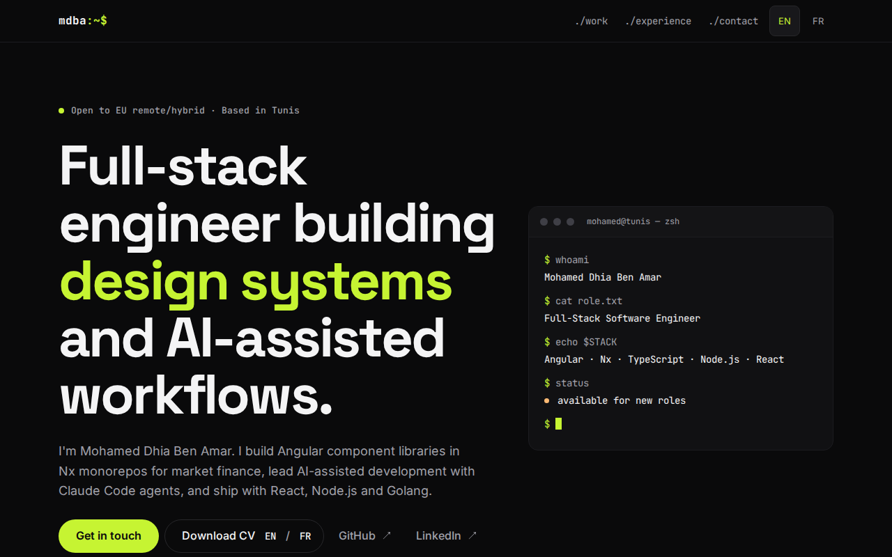
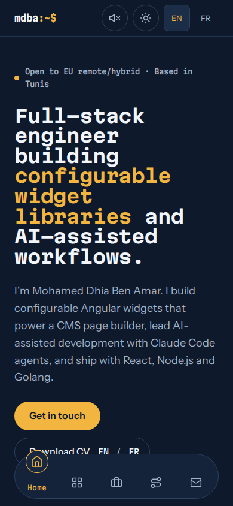
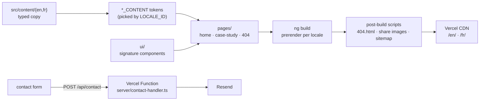

# Mohamed Dhia Ben Amar — Portfolio

Bilingual (English / French) portfolio of a full-stack software engineer, built as a fully
prerendered Angular site. The repository is part of the portfolio: it is meant to show clean
Angular architecture, tests, CI and accessibility, not just the result.

**Live:** https://mohameddhia.dev (`/en/` and `/fr/`)





## Features

- Terminal / code-editor design: a hero you restyle by editing its own JSON config (like the
  configurable widgets I build), editor panes, a status-bar footer,
  in dark and light themes (system setting, or a header toggle that switches with a wave).
- Homepage with highlights, selected projects, an **accessible tabs** experience explorer
  (roving tabindex, arrow keys, Home/End) and a contact form.
- Three case studies (Context → Problem → What I did → Stack → Results → What I'd do next) and a
  terminal-styled 404.
- English and French, each a separate prerendered build with `hreflang` alternates.
- Contact form backed by a Vercel serverless function that validates, rate-limits and emails the
  message through Resend.
- Per-page SEO: canonical URLs, Open Graph and Twitter cards with generated share images,
  `sitemap.xml`, `robots.txt`, Person structured data.

## Stack

| Area      | Choice                                                                               |
| --------- | ------------------------------------------------------------------------------------ |
| Framework | Angular 22: standalone components, signals, `OnPush`, zoneless change detection      |
| Rendering | `@angular/ssr` prerendering (static output), compile-time i18n (`@angular/localize`) |
| Styling   | SCSS with design tokens as CSS custom properties; self-hosted variable fonts         |
| Backend   | Vercel Function (`api/contact.ts`), Zod validation, Resend REST API                  |
| Tests     | Vitest (Angular unit tests + server tests), Playwright + axe-core for e2e            |
| Tooling   | ESLint (angular-eslint), Stylelint, Prettier, Husky + lint-staged, TypeScript strict |
| CI / host | GitHub Actions on every PR and push to `main`; Vercel deploys and PR previews        |

## Architecture



```text
src/
  content/        Typed copy per locale (en/, fr/) and shared content types
  shared/         Rules shared by the form and the API (limits, email pattern, error codes)
  styles/         Design tokens, fonts, base styles, breakpoints
  app/
    core/         Content tokens, locale, SEO, structured data, hreflang, contact client
    layout/       Skip link, header, footer, language switch
    ui/           TerminalWindow, EditorPane, FileExplorer (tabs), CodeView, ProjectCard, …
    pages/        Home (sections/), case study, 404, internal styleguide (noindex)
api/              Vercel Function entry (compiled with api/tsconfig.json → CommonJS)
server/           Contact handler, rate limiter, Resend sender, and their tests
scripts/          Post-build: 404.html, share images + sitemap + robots.txt; local static server
e2e/              Playwright + axe tests, run against the prerendered build
```

Design decisions worth knowing:

- **Content is data.** All copy lives in typed files per locale; templates never hard-code text.
  A parity test fails if English and French drift apart structurally.
- **Components never hard-code colours.** Everything reads design tokens; Stylelint enforces it.
- **No surprises between client and server.** Form validation limits come from one shared file.
- **Facts only.** Case studies use only verified facts; missing ones are visible `[OWNER: …]`
  markers, and any page with a marker is `noindex` and left out of the sitemap.

## Quality

PageSpeed Insights on production (Oct 2026): **mobile 98 / 100 / 100 / 100** and **desktop
100 / 100 / 100 / 100** (performance / accessibility / best practices / SEO).

- **Accessibility:** WCAG 2.2 AA target. axe scans run in e2e on every page (desktop and mobile,
  both locales, error and success states of the form). Skip link, landmarks, visible accent focus,
  keyboard-operable tabs, an error summary that takes focus, `prefers-reduced-motion` respected.
- **Responsive:** every page is checked from 320 px with no horizontal page scroll.
- **Performance:** prerendered HTML, ~85 KB of compressed initial JavaScript, self-hosted fonts
  with metric-matched fallbacks (no layout shift on swap), no third-party scripts besides
  cookieless Vercel Analytics.
- **Tests:** unit tests for components, content, SEO and the API handler; a smoke test that
  compiles the function the way Vercel does; Playwright e2e for navigation, language switch,
  tabs (keyboard included), the contact form (API mocked), SEO tags and 404s.

## Run locally

Requires Node 24+ and pnpm (`corepack enable pnpm`).

```sh
pnpm install
pnpm start          # English dev server on http://localhost:4200
pnpm start:fr       # French dev server
pnpm build          # prerendered site in dist/dhaw-portfolio/browser/{en,fr}
pnpm test           # Angular unit tests + server tests
pnpm e2e            # Playwright + axe against the build (run pnpm build first)
pnpm lint           # ESLint, Stylelint, server type checks
pnpm format         # Prettier
```

The e2e server (`scripts/serve-dist.mjs`) applies the redirects and rewrites from `vercel.json`,
so tests exercise the production routing.

## Deploy

Vercel builds every push: `main` goes to production, pull requests get preview URLs. Settings live
in `vercel.json`. The contact form needs three environment variables in Vercel (see
`.env.example`): `RESEND_API_KEY`, `CONTACT_TO_EMAIL`, `CONTACT_FROM_EMAIL`. Secrets are never
committed. Web Analytics is enabled from the Vercel dashboard.

## Working on it

`CLAUDE.md` holds the conventions (also used by Claude Code, which helped build this site), and
`docs/PORTFOLIO_BRIEF.md` is the source of truth for scope and content.
